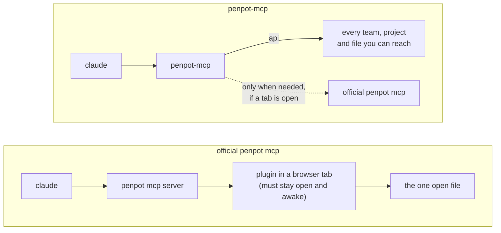

# penpot-mcp

the [official penpot mcp](https://github.com/penpot/penpot/tree/develop/mcp) wants a browser tab
open, a plugin awake and the right file in front of it. i got tired of
babysittin' it, so this one talks to penpot's api directly ~ and still calls
the official one for the few things only a tab can do.

## install

paste this into claude code:

```text
install penpot-mcp from https://github.com/izam-mohammed/penpot-mcp with
`brew install --cask izam-mohammed/tap/penpot-mcp` (or the release binary
for my os if there's no brew), then give me the exact `claude mcp add`
command to run with my penpot access token. don't ask me for the token.
```

### by hand

1. install it:

   ```sh
   brew install --cask izam-mohammed/tap/penpot-mcp
   ```

   no brew? grab a binary from
   [releases](https://github.com/izam-mohammed/penpot-mcp/releases)
   (macos, linux, windows; amd64 and arm64) and put it on your path.

2. make a token in penpot: *your account > integrations > personal access
   tokens*. it's shown once, so copy it.

3. add it to claude code:

   ```sh
   claude mcp add penpot-api -s user \
     -e PENPOT_ACCESS_TOKEN=<your token> \
     -- "$(command -v penpot-mcp)"
   ```

4. restart claude code. `/mcp` should list `penpot-api`.

## how it's different



| | official penpot mcp | penpot-mcp |
| --- | --- | --- |
| needs a browser tab with the plugin running | always | no, optional extras only |
| files it can touch | the one open in the tab | any file your token can reach |
| create, rename, move, delete projects and files | no | yes |
| draw a whole screen in one call | write the plugin code yourself | `draw`, up to 500 shapes |
| text sized with real font metrics | in the tab | yes, no browser |
| library: colours, type styles, components, design tokens | the open file, through plugin code | any file, plus a palette pulled from your repo |
| export boards (png, jpeg, webp, svg, pdf) and `.penpot` files | the open file | any file, straight to disk |
| comments and saved versions | the open file | any file |
| share links and webhooks | no | yes |
| several penpot accounts at once | no | yes |
| plugin code, reflow, css and markup | yes | yes, by calling the official one |

## extras

all optional. set them with more `-e NAME=value` on the `claude mcp add`
line.

| env var | for |
| --- | --- |
| `PENPOT_MCP_URL` | the tab-only tools. *your account > integrations > mcp server*, the whole url, key included |
| `PENPOT_BASE_URL` | a self-hosted penpot (default `https://design.penpot.app`); it needs the `enable-access-tokens` flag |
| `PENPOT_EMAIL`, `PENPOT_PASSWORD` | board exports without a tab. signed in with google? skip these, exports go through the tab |
| `PENPOT_PROFILES` | several accounts: a json file of `{"name", "token_env"}` entries; every tool then takes `profile` |

for clients that only speak http, `penpot-mcp --http 127.0.0.1:8787`
serves the same tools at `/mcp`. off loopback it refuses to start without
`PENPOT_MCP_HTTP_TOKEN` (16+ characters), sent as
`Authorization: Bearer <token>`.

your token never gets logged. still, treat it like a password ~ it is one.

## license

mit, see [LICENSE](LICENSE)
