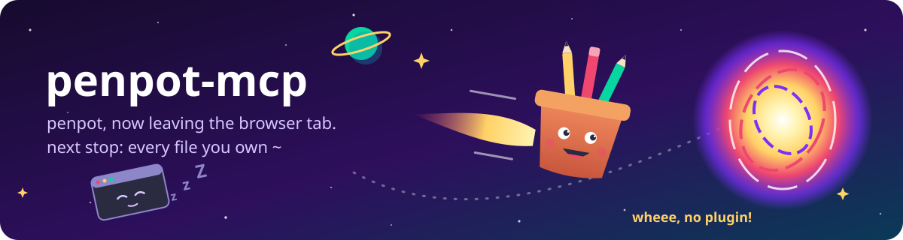
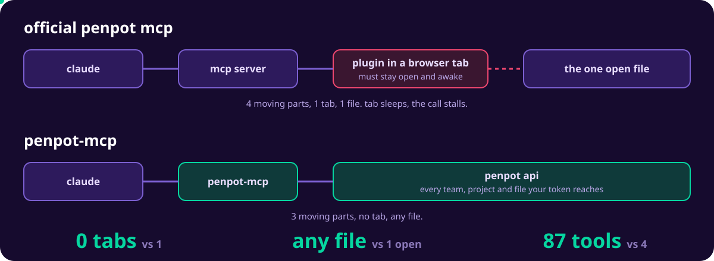
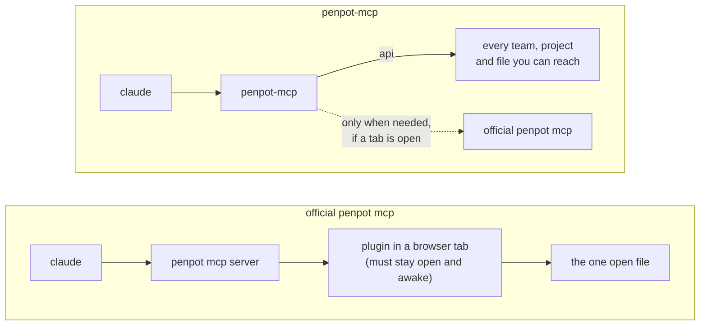

<p align="center"></p>

<p align="center"><a href="https://izam-mohammed.github.io/penpot-mcp/">site</a> · <a href="https://izam-mohammed.github.io/penpot-mcp/docs/">docs</a></p>

<p align="center"><b>penpot mcp that needs no browser tab</b></p>

<p align="center">
<a href="https://github.com/izam-mohammed/penpot-mcp/actions/workflows/check.yml"></a>
<a href="https://github.com/izam-mohammed/penpot-mcp/releases/latest"></a>
<a href="LICENSE"></a>

</p>

<p align="center"></p>

<p align="center"><b>stop babysittin' a browser tab.</b><br>
<a href="#install">install in one line</a> · <a href="https://github.com/izam-mohammed/penpot-mcp/releases/latest">grab a binary</a> · <a href="https://github.com/izam-mohammed/penpot-mcp">star it if it saves you a tab</a></p>

the [official penpot mcp](https://github.com/penpot/penpot/tree/develop/mcp) wants a browser tab
open, a plugin awake and the right file in front of it. i got tired of
babysittin' it, so this one talks to penpot's api directly ~ and still calls
the official one for the few things only a tab can do.

## what a prompt gets you

<!-- demo gif goes in docs/assets/demo.gif; add the img tag here once the file exists -->

say this to your agent, with no penpot tab open anywhere:

```text
make a project called "pocket bank", and in it a file with a login screen:
dark board, logo on top, email and password fields, a green sign in button.
then export the board as a png into docs/.
```

it creates the project and the file, draws the whole screen in one `draw`
call, and writes the png into your repo. no tab was harmed.

## install

paste this into claude code, codex or whatever you use to roam around:

```text
yo bro, install penpot-mcp for me from
https://github.com/izam-mohammed/penpot-mcp. use
`brew install --cask izam-mohammed/tap/penpot-mcp`, or if brew isn't
around, grab the release binary for my os. then run
`penpot-mcp skills install` (add `--agent codex` if you're codex) so you
know how to drive it, and hand me the exact `claude mcp add` command to
run with my penpot access token. don't ask me for the token, it's mine
and i'm keeping it. thanks king.
```

### pick a way in

| how | command |
| --- | --- |
| brew | `brew install --cask izam-mohammed/tap/penpot-mcp` |
| go install | `go install github.com/izam-mohammed/penpot-mcp/cmd/penpot-mcp@latest` |
| curl script | `curl -fsSL https://raw.githubusercontent.com/izam-mohammed/penpot-mcp/main/scripts/install.sh \| sh` |
| docker | `docker build -t penpot-mcp https://github.com/izam-mohammed/penpot-mcp.git` |
| binary | [releases](https://github.com/izam-mohammed/penpot-mcp/releases), macos, linux, windows, amd64 and arm64 |

the curl script checks the download against `checksums.txt` and drops the
binary in `~/.local/bin` (`PENPOT_MCP_INSTALL_DIR` changes that,
`PENPOT_MCP_VERSION` pins a release). it doesn't do windows ~ grab the zip.
the docker image runs over stdio, so the mcp config below uses
`docker run -i --rm`.

### by hand

1. install it with any row above.

2. make a token in penpot: *your account > integrations > personal access
   tokens*. it's shown once, so copy it.

3. tell your agent about it. swap `<your token>` for the real one.

   claude code:

   ```sh
   claude mcp add penpot -s user \
     -e PENPOT_ACCESS_TOKEN=<your token> \
     -- "$(command -v penpot-mcp)"
   ```

   cursor, in `.cursor/mcp.json`:

   ```json
   {
     "mcpServers": {
       "penpot": {
         "command": "penpot-mcp",
         "env": { "PENPOT_ACCESS_TOKEN": "<your token>" }
       }
     }
   }
   ```

   vs code, in `.vscode/mcp.json`:

   ```json
   {
     "servers": {
       "penpot": {
         "type": "stdio",
         "command": "penpot-mcp",
         "env": { "PENPOT_ACCESS_TOKEN": "<your token>" }
       }
     }
   }
   ```

   claude desktop, in `claude_desktop_config.json`:

   ```json
   {
     "mcpServers": {
       "penpot": {
         "command": "penpot-mcp",
         "env": { "PENPOT_ACCESS_TOKEN": "<your token>" }
       }
     }
   }
   ```

   using docker? swap the command in any of them for
   `"command": "docker", "args": ["run", "-i", "--rm", "-e", "PENPOT_ACCESS_TOKEN", "penpot-mcp"]`.
   a gui app might not see your shell's path, so give `command` the full path
   from `command -v penpot-mcp` if it can't find it.

4. give your agent the manual:

   ```sh
   penpot-mcp skills install                # claude code
   penpot-mcp skills install --agent codex  # codex
   ```

5. restart claude code. `/mcp` should list `penpot`, `/skills` the
   `penpot-mcp` ones.

## skills

the binary carries its own skills, so your agent stops guessin' which of
87 tools to call. `penpot-mcp skills install` writes them, from the same
release as the tools they talk about.

| skill | for |
| --- | --- |
| `penpot-mcp` | connecting, the token hand-off, finding and managing files, every error |
| `penpot-mcp-draw` | whole screens in one call, edits, and lookin' at what landed |
| `penpot-mcp-library` | colours, type styles, components, design tokens, your repo's palette |
| `penpot-mcp-export` | boards to png, svg or pdf in your repo, `.penpot` files |
| `penpot-mcp-collab` | comments, share links, webhooks, versions, several accounts |

it won't overwrite a skill it didn't write; `--force` if you mean it.
working on them from a checkout? `make install-skill` links them instead.

## how it's different



| | official penpot mcp | penpot-mcp |
| --- | --- | --- |
| needs a browser tab with the plugin running | always | no, optional extras only |
| files it can touch | the one open in the tab | any file your token can reach |
| create, rename, move, delete projects and files | no | yes |
| draw a whole screen in one call | write the plugin code yourself | `draw`, up to 500 shapes |
| text sized with real font metrics | in the tab | yes, no browser |
| library: colours, type styles, components, design tokens | the open file, through plugin code | any file, plus a palette pulled from your repo |
| export boards (png, jpeg, webp, svg, pdf) and `.penpot` files | the open file | any file, straight to disk |
| comments and saved versions | the open file | any file |
| share links and webhooks | no | yes |
| several penpot accounts at once | no | yes |
| plugin code, reflow, css and markup | yes | yes, by calling the official one |

87 tools in total: 65 need only the access token, 5 are hybrid (api first,
a tab step when one is open), 2 need a login or a tab, 15 need a tab. the
full list is in the [tools reference](skills/penpot-mcp/references/tools.md).

## extras

all optional. set them with more `-e NAME=value` on the `claude mcp add`
line.

| env var | for |
| --- | --- |
| `PENPOT_MCP_URL` | the tab-only tools. *your account > integrations > mcp server*, the whole url, key included |
| `PENPOT_BASE_URL` | a self-hosted penpot (default `https://design.penpot.app`); it needs the `enable-access-tokens` flag |
| `PENPOT_EMAIL`, `PENPOT_PASSWORD` | board exports without a tab. signed in with google? skip these, exports go through the tab |
| `PENPOT_PROFILES` | several accounts: a json file of `{"name", "token_env"}` entries; every tool then takes `profile` |

for clients that only speak http, `penpot-mcp --http 127.0.0.1:8787`
serves the same tools at `/mcp`. off loopback it refuses to start without
`PENPOT_MCP_HTTP_TOKEN` (16+ characters), sent as
`Authorization: Bearer <token>`.

your token never gets logged. still, treat it like a password ~ it is one.

## license

mit, see [LICENSE](LICENSE)
